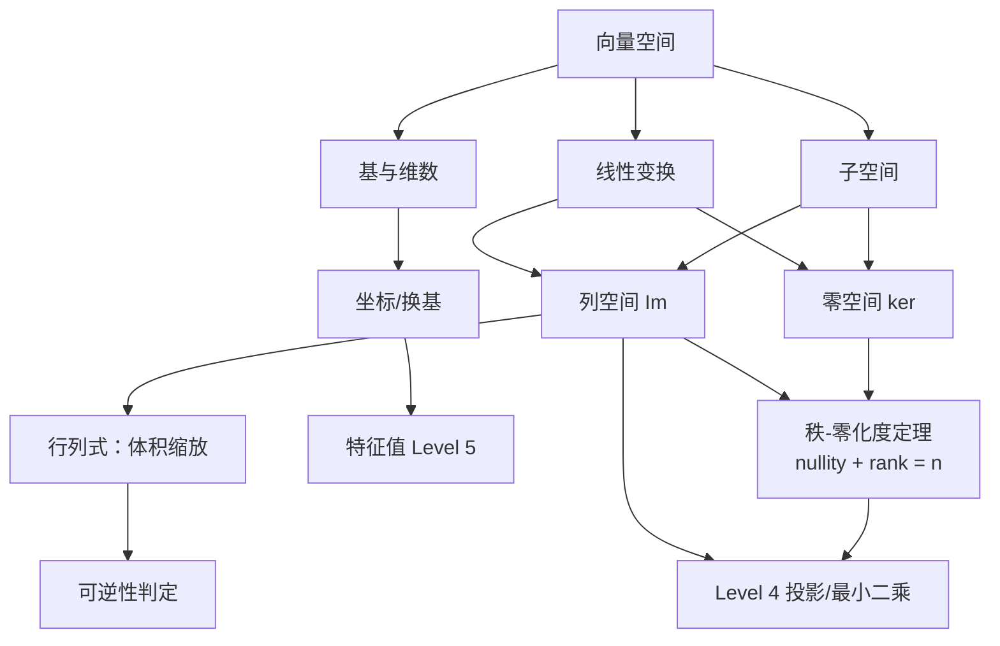

# Level 3 向量空间

> 本章是从"具体计算"到"抽象结构"的**视角升级**：不再把向量看作一串数字，而是看作"可以相加、可以缩放"的抽象对象；矩阵也从"数表"升级为"空间之间的线性变换"。
>
> 知识主线：**向量空间 → 子空间 → 基与维数 → 坐标 → 线性变换 → 核与像 → 秩-零化度定理 → 行列式**

## 学习目标

完成本章后，你应该能够：

- 用公理化方式理解向量空间，判断一个集合"是不是"向量空间；
- 区分子空间与"普通子集"，并验证子空间；
- 理解基 = 极小生成集 = 极大无关组，维数 = 基的大小；
- 理解坐标表示：基就是"坐标系"，坐标就是"系数"；
- 理解线性变换与矩阵的对应关系，以及**核（零空间）与像（列空间）**的含义；
- 掌握**秩-零化度定理** $\dim(\ker A) + \operatorname{rank}(A) = n$；
- 理解行列式的几何意义：体积缩放因子，以及它如何判定可逆性。

---

## 第一部分：向量空间

### 1. 为什么要抽象：从"数字列表"到"结构"

Level 1 把向量理解为"带位置的数值组"。但很多看起来不像"数字列表"的东西，行为却和向量一模一样：

- 所有多项式 $ax^2 + bx + c$（可以相加、乘常数）；
- 所有 $m \times n$ 矩阵（可以相加、乘常数，Level 1 已预告）；
- 所有函数 $f: \mathbb{R} \to \mathbb{R}$（逐点相加、逐点缩放）；
- 所有解（齐次方程组的解集，Level 2 已见雏形）。

> [!abstract] 抽象的力量
> 数学家的做法：**把"能相加、能缩放"作为唯一特征提取出来**，定义成公理。之后所有结论（基、维数、线性变换）对上面所有对象**同时成立**。这就是"抽象"——一次证明，处处适用。

### 2. 向量空间的公理化定义

**定义**：集合 $V$（元素称**向量**）配备两个运算（加法 $+$ 与数乘 $\cdot$），若对任意 $\mathbf{u},\mathbf{v},\mathbf{w} \in V$、任意标量 $a,b \in \mathbb{R}$ 满足以下**十条公理**，则称 $V$ 为（实）向量空间：

| 类别 | 公理 | 直觉 |
| --- | --- | --- |
| 加法封闭 | $\mathbf{u}+\mathbf{v} \in V$ | 加完还在里面 |
| 数乘封闭 | $a\mathbf{u} \in V$ | 缩放完还在里面 |
| 加法交换 | $\mathbf{u}+\mathbf{v}=\mathbf{v}+\mathbf{u}$ | 顺序无所谓 |
| 加法结合 | $(\mathbf{u}+\mathbf{v})+\mathbf{w}=\mathbf{u}+(\mathbf{v}+\mathbf{w})$ | 括号无所谓 |
| 零元 | $\exists \mathbf{0},\ \mathbf{u}+\mathbf{0}=\mathbf{u}$ | 有"什么都不加"的元素 |
| 负元 | $\forall \mathbf{u},\ \exists (-\mathbf{u}),\ \mathbf{u}+(-\mathbf{u})=\mathbf{0}$ | 每个元素有"相反"元素 |
| 数乘结合 | $a(b\mathbf{u})=(ab)\mathbf{u}$ | 缩放两次 = 缩放一次 |
| 数乘分配① | $(a+b)\mathbf{u}=a\mathbf{u}+b\mathbf{u}$ | 对数的分配 |
| 数乘分配② | $a(\mathbf{u}+\mathbf{v})=a\mathbf{u}+a\mathbf{v}$ | 对向量的分配 |
| 单位缩放 | $1\mathbf{u}=\mathbf{u}$ | 乘 1 不变 |

> [!note] 快速验证法
> 实际判断"是不是向量空间"只需验证三点：① 加法封闭；② 数乘封闭；③ 含零元。其余公理由"继承"得来（如实数运算性质）。
> 例：第一象限 $\{(x,y): x \ge 0\}$ 不封闭（数乘 $-1$ 就出去了）；$\{(x,y): x+y=0\}$ 是向量空间（过原点的直线）。

**AI 联系**：特征空间 $\mathbb{R}^n$ 是向量空间；**嵌入空间（embedding space）**也是——词向量可以相加（"国王 − 男人 + 女人 ≈ 女王"正是加法封闭的体现）。

### 3. 子空间

**定义**：$V$ 的非空子集 $W$，若 $W$ 自身（用同样的加法与数乘）是向量空间，则称 $W$ 是 $V$ 的**子空间**。

**验证子空间的三个条件**（比验证整个向量空间简单）：

1. $\mathbf{0} \in W$（含零元）；
2. 加法封闭：$\mathbf{u}, \mathbf{v} \in W \Rightarrow \mathbf{u}+\mathbf{v} \in W$；
3. 数乘封闭：$\mathbf{u} \in W,\ c \in \mathbb{R} \Rightarrow c\mathbf{u} \in W$。

**几何直觉**：子空间是"过原点"的平直切片——过原点的直线、平面、超平面；**不过原点的直线不是子空间**（数乘会把它移出）。

> [!example] 子空间的典型例子
> - 过原点的直线 $\{t\mathbf{v}\}$；过原点的平面；
> - **零空间**（Level 2 齐次解集）：$A\mathbf{x}=\mathbf{0}$ 的解集是 $\mathbb{R}^n$ 的子空间；
> - **列空间**：$A$ 的列向量张成的空间是 $\mathbb{R}^m$ 的子空间；
> - 多项式空间中的"次数 ≤ 2 的多项式"是子空间；"次数 = 2"**不是**（加法可能降次，且不含零多项式）。

---

## 第二部分：生成、基与维数

### 4. 生成集与张成空间

**定义**：向量组 $\{\mathbf{v}_1,\dots,\mathbf{v}_k\}$ 的**张成空间**（span）是所有线性组合的集合：

$$
\operatorname{span}\{\mathbf{v}_1,\dots,\mathbf{v}_k\} = \{a_1\mathbf{v}_1 + \cdots + a_k\mathbf{v}_k : a_i \in \mathbb{R}\}
$$

**直觉**：span = "用这些向量能到达的所有地方"。span 一定是子空间（线性组合的线性组合还是线性组合）。

**生成集**：若 $\operatorname{span}\{\mathbf{v}_1,\dots,\mathbf{v}_k\} = W$，则称这组向量**生成** $W$。

### 5. 线性无关与基

**线性无关**（回顾 Level 1）：$c_1\mathbf{v}_1+\cdots+c_k\mathbf{v}_k=\mathbf{0}$ 只有全零解。

**基（basis）**：$W$ 的一组向量，同时满足：

1. **线性无关**（没有冗余）；
2. **生成 $W$**（够用）。

**基 = 极小生成集 = 极大线性无关组**。直觉：基是"恰好够用的最小骨架"——少了不够生成，多了就有冗余。

> [!example] 标准基
> $\mathbb{R}^n$ 的标准基：$\mathbf{e}_1=(1,0,\dots,0),\dots,\mathbf{e}_n=(0,\dots,1)$。
> 向量 $\mathbf{x}=(x_1,\dots,x_n)$ 用标准基写就是 $\mathbf{x}=x_1\mathbf{e}_1+\cdots+x_n\mathbf{e}_n$——**系数即坐标**。

### 6. 维数与坐标

**维数**：$W$ 的**任何**基所含向量个数都相同，这个数称为 $\dim W$。

> [!tip] 维数 = 独立方向的个数
> 直线的维数是 1，平面的维数是 2，$\mathbb{R}^n$ 的维数是 $n$。维数衡量"这个空间有多大（多少个自由方向）"——对应 Level 2 的"自由变量个数"。

**坐标（coordinates）**：固定基 $\mathcal{B}=\{\mathbf{v}_1,\dots,\mathbf{v}_n\}$ 后，任意 $\mathbf{x} \in W$ 可以**唯一**写成

$$
\mathbf{x} = c_1\mathbf{v}_1 + \cdots + c_n\mathbf{v}_n
$$

$(c_1,\dots,c_n)$ 称为 $\mathbf{x}$ 在基 $\mathcal{B}$ 下的**坐标**，记为 $[\mathbf{x}]_{\mathcal{B}}$。

**基 = 坐标系**：同一个向量在不同基下坐标不同（比如旋转坐标系后，同一个点的新坐标变了）。Level 5 的特征基、Level 6 的 SVD 基，本质都是"换坐标系让问题变简单"。

**AI 联系**：
- **降维**：PCA 在数据空间中找一组正交基，用"信息最多的前 $k$ 个方向"近似表示数据——维数从 $d$ 降到 $k$；
- **嵌入**：词向量的"坐标"就是其在基下的系数；语义轴（性别、时态）常对应某些基方向；
- **维度灾难**：维数越高，空间中点越稀疏、距离越不可靠——理解维数概念是理解它的前提。

---

## 第三部分：线性变换、核与像

### 7. 线性变换回顾与矩阵对应

**定义**（Level 1 回顾）：$T: V \to W$ 满足 $T(\mathbf{u}+\mathbf{v})=T(\mathbf{u})+T(\mathbf{v})$、$T(c\mathbf{u})=cT(\mathbf{u})$。

**表示定理**：固定基后，任意线性变换都能写成矩阵乘法 $T(\mathbf{x})=A\mathbf{x}$；反之任何矩阵都定义了一个线性变换。**矩阵与线性变换是同一枚硬币的两面**（Level 1 结论的严格化）。

> [!warning] 常见误区
> 误区：线性变换 = 旋转/拉伸这类"几何变换"。→ 正确：**求导也是线性变换**（$\frac{d}{dx}(f+g)=\frac{df}{dx}+\frac{dg}{dx}$）；积分也是；神经网络中"无偏置的权重层"也是。凡保持线性组合的映射都是线性变换。

### 8. 核（零空间）与像（列空间）

**核 / 零空间（kernel / null space）**：$T$ 映射到零的输入集合

$$
\ker T = \{\mathbf{x} : T(\mathbf{x}) = \mathbf{0}\} \quad(= \operatorname{Null}(A)\ \text{当 } T(\mathbf{x})=A\mathbf{x})
$$

- 直觉：**被 $T$ 压扁/压缩掉的"信息"**——输入里那些被映射到零的部分；
- 它是 $V$ 的子空间（Level 2 齐次解集即此）；
- $\dim(\ker T)$ 称为**零化度**（nullity）。

**像（image / range）**：$T$ 实际到达的输出集合

$$
\operatorname{Im} T = \{T(\mathbf{x}) : \mathbf{x} \in V\} \quad(= \operatorname{Col}(A)\ \text{当 } T(\mathbf{x})=A\mathbf{x})
$$

- 直觉：**$T$ 的输出能覆盖的范围**；
- 它是 $W$ 的子空间；$\dim(\operatorname{Im} T) = \operatorname{rank}(A)$。

> [!tip] 两个视角统一
> - **零空间**回答："哪些输入被压成零？"（信息丢失了多少自由度）
> - **列空间**回答："输出能到达哪里？"（保留了哪些方向）
> - 两者互补：输入空间的大小 = 保留的（rank）+ 丢掉的（nullity）。

### 9. 秩-零化度定理（Rank-Nullity Theorem）

$$
\boxed{\ \dim(\ker T) + \dim(\operatorname{Im} T) = \dim V\ }
$$

对矩阵形式：$\operatorname{nullity}(A) + \operatorname{rank}(A) = n$（$n$ 为 $A$ 的列数）。

**直觉**：$n$ 维输入经过 $A$ 后，$\operatorname{rank}$ 个方向被保留下来，剩下的 $\operatorname{nullity}=n-\operatorname{rank}$ 个方向被压成零——总自由度守恒。

**与 Level 2 的联系**：$n - \operatorname{rank}(A)$ 正是自由变量个数！秩-零化度定理把"解的结构"（Level 2）提升为"空间结构"（Level 3）的定理。

> [!example] 秩-零化度定理的使用
> 若 $A$ 是 $3 \times 5$ 矩阵且 $\operatorname{rank}(A)=2$，则零化度 $= 5-2=3$：$A\mathbf{x}=\mathbf{0}$ 的解空间是 $\mathbb{R}^5$ 中的三维子空间。

**AI 联系**：
- **秩不足 = 信息不足**：设计矩阵 $X$ 秩不足时，回归参数不可唯一确定（Level 2 可辨识性），需要正则化；
- **压缩与重构**：线性映射 $A$（编码）把高维输入压到低维，rank 决定"最多保留多少信息"——低秩近似（Level 6）正是"牺牲 rank 换压缩"；
- **神经网络层**：权重矩阵 $W$ 的秩决定该层输出张成的子空间维数；奇异值/秩分析用于压缩与解释（LoRA 等低秩方法）。

---

## 第四部分：行列式

### 10. 行列式的几何意义

**行列式**（determinant）$\det(A)$：方阵 $A$ 对应的线性变换**体积缩放因子**：

- $|\det(A)|$ = 单位体积被放大（$>1$）或缩小（$<1$）的倍数；
- $\det(A)>0$：变换保持方向（右手系不变）；$\det(A)<0$：翻转方向（镜像）；
- $\det(A)=0$：**体积被压成零** —— 空间被压扁到更低维，即 $A$ **不可逆**。

$$
\det(I)=1,\quad \det(cA)=c^n\det(A),\quad \det(AB)=\det(A)\det(B),\quad \det(A^T)=\det(A)
$$

> [!tip] 为什么行列式为 0 ⇔ 不可逆
> 体积缩放到 0 = 变换把某个方向压扁 = 有非零向量被映射到零 = 零空间非平凡（nullity ≥ 1）= 秩不足 = 不可逆。五个说法说的是同一件事。

**$2\times2$ 与 $3\times3$ 行列式**：

$$
\det\begin{pmatrix}a&b\\c&d\end{pmatrix}=ad-bc, \qquad
\det\begin{pmatrix}a&b&c\\d&e&f\\g&h&i\end{pmatrix}=a(ei-fh)-b(di-fg)+c(dh-eg)
$$

**计算方法**（按需，不追求技巧）：拉普拉斯展开（按行/列展开，适合小型矩阵）；数值计算交给 `np.linalg.det`（大型矩阵不用手算）。

> [!warning] 常见误区
> 误区：行列式是"求面积/体积的公式"。→ 正确：它是**变换**的体积缩放因子——不是"图形的面积"，而是"变换放大或缩小了多少"。$\det$ 描述变换，不是描述图形本身。

**AI 联系**：$\det(W) \neq 0$ 判定权重矩阵可逆（信息无损）；概率中的**雅可比行列式**（Level 8）是"变量替换下概率密度如何缩放"，与归一化流（normalizing flow）直接相关；行列式与特征值乘积的关系 $\det(A)=\prod\lambda_i$（Level 5）。

---

## 常见误区汇总

1. **"向量必须是一串数字"** → 向量是"可相加可缩放的对象"，数字只是其在某基下的表示；
2. **"子空间 = 任意子集"** → 子空间必须含零元且对加法和数乘封闭；不过原点的直线不是子空间；
3. **"维数 = 向量个数"** → 维数 = 基的大小 = 独立方向数；一组 5 个相关向量最多张成 4 维空间；
4. **"基是唯一的"** → 基不唯一（可旋转、缩放基向量），但**维数唯一**；
5. **"线性变换就是旋转缩放"** → 求导、积分、投影都是线性变换；
6. **"行列式为 0 只是'算出来是 0'"** → 行列式为 0 意味着变换把空间压扁、矩阵不可逆、有非平凡零空间——几何与代数是一体的；
7. **"秩-零化度定理是公式"** → 它是"自由度守恒"：$n$ 维输入 = 保留的（rank）+ 丢掉的（nullity）。

---

## 知识结构图

## 思考问题

1. 第一象限 $\{(x,y): x\ge0\}$ 为什么不是向量空间？过原点的直线为什么是？
2. 为什么验证子空间只需要三条（含零元、加封闭、数乘封闭），不用验证全部十条公理？
3. 多项式 $\{ax^2+bx+c\}$ 的一组基是什么？维数是几？
4. $A$ 是 $3\times5$ 矩阵、$\operatorname{rank}=2$，$A\mathbf{x}=\mathbf{0}$ 的解空间维数是多少？为什么（用秩-零化度定理）？
5. 为什么 $\det(A)=0$ 与"$A$ 不可逆"等价？用几何语言解释。
6. 神经网络一层 $W\mathbf{x}$（无偏置）为什么是线性变换？如果 $\operatorname{rank}(W)$ 小于输出维数，说明什么？
7. 思考（预告）：为什么说"换基 = 换坐标系"，特征基（Level 5）能让矩阵变成对角形？

## 总结

**Level 3 的知识网络**：

**向量空间（公理）→ 子空间 → 生成/无关 → 基（最小骨架）→ 维数（独立方向数）→ 坐标（基下系数）→ 线性变换 → 核（被压扁的）→ 像（能到达的）→ 秩-零化度（自由度守恒）→ 行列式（体积缩放）→ 可逆性**

一句话总结：**Level 3 把"数字"升级为"结构"——向量空间是舞台，基是坐标系，线性变换是演员，核与像是它"丢了什么、留下什么"，行列式告诉我们变换"放大了多少"。** 下一章（Level 4）将在内积空间中研究"如何找到最优近似"（投影与最小二乘）。

## 推荐资料

- **Strang《Introduction to Linear Algebra》第 3 章**——难度：入门–中等。理由：子空间、基、维数讲得最直观，配 MIT 18.06 视频（第 9–12 讲）。
- **Axler《线性代数应该这样学》（Linear Algebra Done Right）第 1–3 章**——难度：进阶。理由：公理化风格，强调"不用行列式也能做线代"，适合精读对照。
- **3Blue1Brown《线性代数的本质》第 8–13 集**——难度：零基础。理由：基变换、线性变换、行列式的几何直觉全覆盖。
- **Lay《线性代数及其应用》第 4 章**——难度：入门–中等。理由：子空间与基的例题规范、体系完整。

> 若遇到解决不了的疑问，请在笔记中用 `> [!question]` 标记，按 config.md 的规范跟踪解决。

## Related Notes

- [[Level1_Vectors_and_Matrices|Level 1 向量与矩阵]] —— 前置基础
- [[Level2_Linear_Systems|Level 2 线性方程组]] —— 前置基础（解结构与秩）
- [[Level4_Orthogonality_and_Projection|Level 4 正交与投影]] —— 下一章
- [[Linear Algebra MOC]] —— 知识库总览
- [[Learning_Roadmap]] —— 学习路线
- [[Glossary]] —— 术语表
