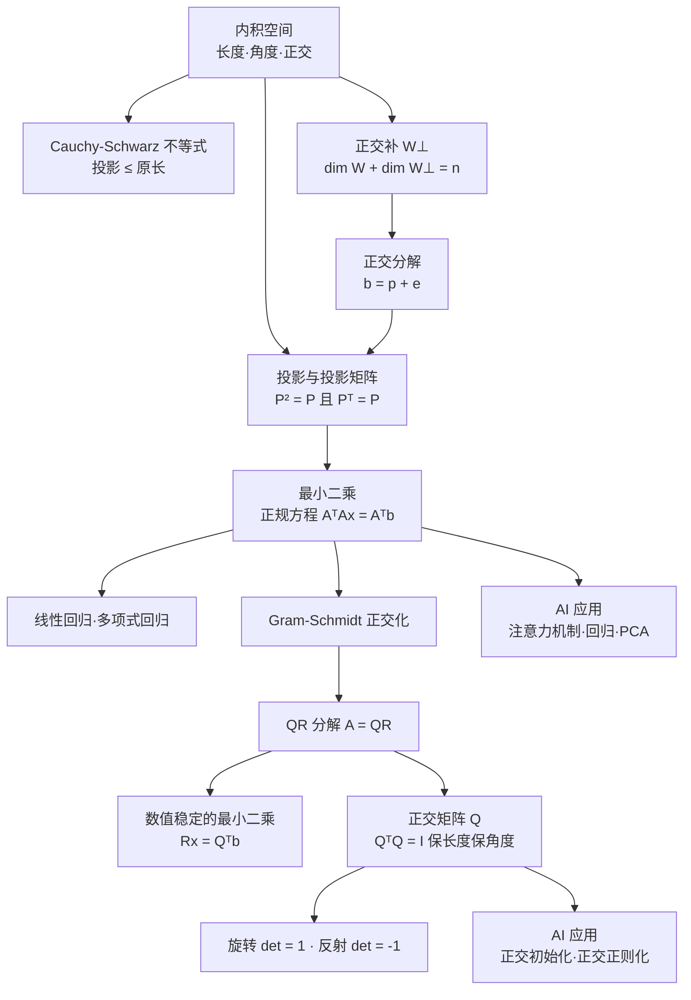

# Level 4 正交与投影

> 本章回答一个"看起来不可能"的问题：**$A\mathbf{x} = \mathbf{b}$ 无解时，怎么办？** 答案出人意料地漂亮——求一个**最优的近似解**，而它恰好是 $\mathbf{b}$ 到某个子空间的**投影**。投影、最小二乘、Gram-Schmidt 正交化，本质上是同一件事的三个侧面：**在向量空间中如何找到"最佳近似"**。
>
> 知识主线：**内积空间（长度/角度/正交）→ 正交补 → 投影 → 最小二乘（正规方程）→ Gram-Schmidt 正交化 → QR 分解雏形 → 正交矩阵（旋转与反射）**

## 学习目标

完成本章后，你应该能够：

- 理解内积空间的几何：长度、角度、正交，以及 Cauchy-Schwarz 不等式为什么只是"投影 ≤ 原长"；
- 掌握投影矩阵的公式与两条核心性质（$P^2 = P$、$P^T = P$），理解"投影 = 最近点 = 最佳近似"；
- 从几何（误差正交于列空间）与代数（正规方程）两个角度理解最小二乘，能解释"最佳拟合"为什么是投影；
- 会用 Gram-Schmidt 过程把任意基改造成正交基，看懂 QR 分解 $A = QR$ 的雏形；
- 理解正交矩阵 $Q$（$Q^TQ = I$）保长度、保角度的本质，认识旋转与反射。

> [!note] 前置知识
> 本章需要 Level 1（点积、范数、矩阵乘法、转置）与 Level 3（子空间、列空间、零空间、基与维数）。若对"$\mathbf{b}$ 不在列空间里"这句话没有感觉，建议先回看 Level 3 的像与核部分。

---

## 第一部分：内积空间

### 1. 从点积到内积：度量"大小与方向"的尺子

Level 1 定义了 $\mathbb{R}^n$ 上的点积，但 Level 3 告诉我们：向量空间的元素可以是多项式、函数、矩阵。要给这些对象谈"长度、角度"，就需要把点积推广成**内积**（inner product）。

**定义**：实向量空间 $V$ 上的内积是一个二元函数 $\langle \cdot, \cdot \rangle: V \times V \to \mathbb{R}$，满足三条公理：

1. **对称性**：$\langle \mathbf{u}, \mathbf{v} \rangle = \langle \mathbf{v}, \mathbf{u} \rangle$；
2. **线性**（对第一个参数）：$\langle a\mathbf{u} + b\mathbf{v}, \mathbf{w} \rangle = a\langle \mathbf{u}, \mathbf{w} \rangle + b\langle \mathbf{v}, \mathbf{w} \rangle$（结合对称性，对第二个参数也自动线性）；
3. **正定性**：$\langle \mathbf{v}, \mathbf{v} \rangle \ge 0$，且等号当且仅当 $\mathbf{v} = \mathbf{0}$。

配备了内积的向量空间称为**内积空间**（inner product space）。

> [!note] 点积是内积的特例
> $\mathbb{R}^n$ 上的标准点积 $\langle \mathbf{x}, \mathbf{y} \rangle = x_1y_1 + \cdots + x_ny_n = \mathbf{x}^T\mathbf{y}$ 满足全部三条公理，是最常用的"一把尺子"。但尺子不唯一：例如加权点积 $\langle \mathbf{x}, \mathbf{y} \rangle_w = \sum_i w_i x_i y_i$（各 $w_i > 0$）也是内积——它对应**加权欧氏距离**，是带权回归、马氏距离（Mahalanobis distance）的思想雏形。

> [!example] 多项式上的内积
> 对次数不超过 $n$ 的多项式空间，$\langle p, q \rangle = \int_0^1 p(x)q(x)\,dx$ 是内积。这意味着投影与最小二乘的理论不只属于 $\mathbb{R}^n$——**用多项式去拟合函数曲线**（函数空间里的最小二乘）用的是同一套语言。

### 2. 长度、角度与正交

有了内积，就能定义三个几何量：

- **长度/范数**：$\|\mathbf{v}\| = \sqrt{\langle \mathbf{v}, \mathbf{v} \rangle}$（Level 1 的欧氏范数是特例）；
- **夹角**：$\cos\theta = \dfrac{\langle \mathbf{u}, \mathbf{v} \rangle}{\|\mathbf{u}\| \|\mathbf{v}\|}$；
- **正交**（orthogonal）：$\langle \mathbf{u}, \mathbf{v} \rangle = 0$，记作 $\mathbf{u} \perp \mathbf{v}$。零向量与所有向量都正交。

> [!tip] 正交 = 方向独立
> 正交不只是"垂直"。在数据意义上，正交方向意味着"互不相关、信息不重叠"：沿正交方向的分量可以互不干扰地分别处理——这正是后面投影、PCA 反复依赖的性质。

**Cauchy-Schwarz 不等式**（内积空间最基本的不等式）：

$$
|\langle \mathbf{u}, \mathbf{v} \rangle| \le \|\mathbf{u}\| \cdot \|\mathbf{v}\|, \qquad \text{等号} \iff \mathbf{u}, \mathbf{v} \text{线性相关}
$$

**直觉推导**（直接用到本章主题——投影）：把 $\mathbf{u}$ 分解为"沿 $\mathbf{v}$ 的分量 + 垂直分量"：

$$
\mathbf{u} = \frac{\langle \mathbf{u}, \mathbf{v} \rangle}{\|\mathbf{v}\|^2}\,\mathbf{v} + \mathbf{w}, \qquad \mathbf{w} \perp \mathbf{v}
$$

两个分量正交，由勾股定理：$\|\mathbf{u}\|^2 = \dfrac{\langle \mathbf{u},\mathbf{v}\rangle^2}{\|\mathbf{v}\|^2} + \|\mathbf{w}\|^2 \ge \dfrac{\langle \mathbf{u},\mathbf{v}\rangle^2}{\|\mathbf{v}\|^2}$，移项即得不等式。**它的本质是：投影（直角边）不会长过原向量（斜边）。**

> [!warning] 为什么必须有 Cauchy-Schwarz
> 若 $|\cos\theta| > 1$，"夹角"就定义不出来。Cauchy-Schwarz 保证 $\cos\theta \in [-1, 1]$，角度概念才自洽。它还直接推出**三角不等式** $\|\mathbf{u} + \mathbf{v}\| \le \|\mathbf{u}\| + \|\mathbf{v}\|$——一切"度量几何"的地基。

### 3. 正交补

**定义**：设 $W$ 是内积空间 $V$ 的子空间，$W$ 的**正交补**（orthogonal complement）是 $V$ 中与 $W$ 每个向量都正交的向量全体：

$$
W^{\perp} = \{\mathbf{v} \in V : \langle \mathbf{v}, \mathbf{w} \rangle = 0,\ \forall \mathbf{w} \in W\}
$$

**性质**（有限维内积空间）：

- $W^{\perp}$ 是 $V$ 的子空间；
- $\dim W + \dim W^{\perp} = \dim V$；
- $(W^{\perp})^{\perp} = W$；
- $V = W \oplus W^{\perp}$：**任意** $\mathbf{v} \in V$ 可**唯一**分解为 $\mathbf{v} = \mathbf{p} + \mathbf{e}$，其中 $\mathbf{p} \in W$、$\mathbf{e} \in W^{\perp}$。这就是**正交分解**——下一部分的投影 $\mathbf{p}$ 就是分解的第一块。

> [!example] 正交补的几何例子
> - 在 $\mathbb{R}^2$ 中，直线 $y = x$ 的正交补是直线 $y = -x$；
> - 在 $\mathbb{R}^3$ 中，$xy$ 平面（$z = 0$）的正交补是 $z$ 轴；
> - 衔接 Level 3 的四个基本子空间：$\operatorname{Row}(A)^{\perp} = \operatorname{Null}(A)$（在 $\mathbb{R}^n$ 中），$\operatorname{Col}(A)^{\perp} = \operatorname{Null}(A^T)$（在 $\mathbb{R}^m$ 中）。Strang 最强调的图景：**行空间与零空间、列空间与左零空间两两正交互补**。

**AI 应用**（内积 / 正交 / 正交补）：

- **注意力机制**：Transformer（Vaswani et al., "Attention Is All You Need", 2017）中注意力分数 $\text{softmax}(QK^T / \sqrt{d_k})$ 的 $QK^T$，其每个元素都是 query 与 key 的内积 $\mathbf{q}^T\mathbf{k} = \|\mathbf{q}\|\|\mathbf{k}\|\cos\theta$——**内积大 = 方向接近 = 相似度高**。"相似度即投影的直觉"（Learning_Roadmap 原话）指的就是这里（Level 8 完整展开）；
- **余弦相似度**：$\cos(\mathbf{u},\mathbf{v}) = \dfrac{\mathbf{u}^T\mathbf{v}}{\|\mathbf{u}\|\|\mathbf{v}\|}$ 把"长度"归一化、只看方向，是 word2vec 近义词检索、RAG 向量数据库（如 FAISS）召回排序的标准度量；
- **正交补 = 未被解释的部分**：回归中残差 $\mathbf{e}$ 落在列空间的正交补里（后面会证明 $A^T\mathbf{e} = \mathbf{0}$）；PCA 丢弃的"低方差方向"构成的子空间，正是主成分空间的正交补。

---

## 第二部分：投影

### 4. 一维投影：把向量"压"到一条直线上

**问题**：给定向量 $\mathbf{b}$ 与一条直线（方向由 $\mathbf{a}$ 张成），求直线上离 $\mathbf{b}$ **最近**的点 $\mathbf{p}$。

直线上任意点形如 $\mathbf{p} = \mathbf{a}x$。要求误差向量 $\mathbf{e} = \mathbf{b} - \mathbf{p}$ 垂直直线（几何直觉：最近距离走垂线）：

$$
\mathbf{a}^T(\mathbf{b} - x\mathbf{a}) = 0 \quad\Longrightarrow\quad x = \frac{\mathbf{a}^T\mathbf{b}}{\mathbf{a}^T\mathbf{a}}
$$

于是

$$
\mathbf{p} = \mathbf{a}\,x = \frac{\mathbf{a}^T\mathbf{b}}{\mathbf{a}^T\mathbf{a}}\,\mathbf{a} = P\mathbf{b}, \qquad P = \frac{\mathbf{a}\mathbf{a}^T}{\mathbf{a}^T\mathbf{a}}
$$

其中 $\mathbf{a}\mathbf{a}^T$ 是**外积**（矩阵），$\mathbf{a}^T\mathbf{a}$ 是标量。

> [!tip] 为什么"垂直"给出"最近"
> 直角三角形斜边最长：对直线上任意点 $\mathbf{a}x$，由正交分解
> $$
> \|\mathbf{b} - \mathbf{a}x\|^2 = \|\mathbf{e}\|^2 + \|\mathbf{a}(x^{*} - x)\|^2 \ge \|\mathbf{e}\|^2
> $$
> 等号仅在 $x = x^{*}$ 时取到。**误差垂直于直线 ⟺ 距离最小**——这是最小二乘一切结论的几何根源，务必记住。

> [!example] 数值例子
> $\mathbf{a} = (1, 2)$，$\mathbf{b} = (1, 1)$：$x = \dfrac{1+2}{1+4} = \dfrac{3}{5}$，所以 $\mathbf{p} = \left(\dfrac{3}{5}, \dfrac{6}{5}\right)$，$\mathbf{e} = \left(\dfrac{2}{5}, -\dfrac{1}{5}\right)$。验证 $\mathbf{a}^T\mathbf{e} = \dfrac{2}{5} - \dfrac{2}{5} = 0$ ✓。

### 5. 多维投影与投影矩阵的性质

把一维结论推广到投影到子空间 $W = \operatorname{Col}(A)$（$A$ 为 $m \times n$，**列满秩**）：

$$
\mathbf{p} = A\mathbf{x} = A(A^TA)^{-1}A^T\mathbf{b}, \qquad P = A(A^TA)^{-1}A^T
$$

推导与一维完全平行：$\mathbf{p} = A\mathbf{x}$ 是列空间里的点，要求 $\mathbf{e} = \mathbf{b} - A\mathbf{x}$ 与**每一列**都正交（等价于与整个列空间正交）：

$$
A^T(\mathbf{b} - A\mathbf{x}) = \mathbf{0} \quad\Longrightarrow\quad A^TA\mathbf{x} = A^T\mathbf{b} \quad\Longrightarrow\quad \mathbf{x} = (A^TA)^{-1}A^T\mathbf{b}
$$

**投影矩阵的两条核心性质**（动手验证它们是理解投影的钥匙）：

1. **幂等**：$P^2 = P$——投影两次等于投影一次（投影后已在 $W$ 里，再投影不动它）；
2. **对称**：$P^T = P$——这是**正交投影**（垂直投影）的标志；若不对称，就是斜投影（如阴影投射，不保证"最近"）。

> [!note] 投影矩阵的两个极端行为
> - $\mathbf{b} \in W$ 时，$P\mathbf{b} = \mathbf{b}$（本来就"在里面"，投影不动它）；
> - $\mathbf{b} \perp W$ 时，$P\mathbf{b} = \mathbf{0}$（完全被滤掉）。
> 任意 $\mathbf{b}$ 都分解为 $W$ 分量 + $W^{\perp}$ 分量：$\mathbf{b} = P\mathbf{b} + (I - P)\mathbf{b}$，其中 $I - P$ 正是投影到 $W^{\perp}$ 的矩阵。这与 3 节的正交分解 $V = W \oplus W^{\perp}$ 完全呼应。

> [!warning] 常见误区
> 误区：$P = A(A^TA)^{-1}A^T$ 要求 $A$ 可逆。→ 正确：$A$ 只需要**列满秩**（保证 $A^TA$ 可逆），甚至不要求是方阵；$A$ 本身不可逆时投影照样存在（列不满秩时要用伪逆，见 Level 6）。

**AI 应用**（投影）：

- **降维 = 正交投影**：PCA 把数据投影到"方差最大的正交方向"上，丢弃其在正交补方向的分量（Level 5 给出完整推导）；更一般地，任何"把高维表示压到低维子空间"的操作都含投影；
- **注意力机制的再解读**：$\text{softmax}(QK^T/\sqrt{d_k})\,V$ 是对 $V$ 的加权组合，权重来自 $Q$/$K$ 内积——"按相似度（投影长度的直觉）从 value 里提取信息"，与"把 query 投影到 key 确定的方向"是同一思想；
- **最优线性滤波**：含噪信号 $x + n$ 在信号子空间上的投影能"滤掉"落在正交补（噪声子空间）里的成分，这是信号处理中子空间方法（如 MUSIC）的出发点。

---

## 第三部分：最小二乘

### 6. 无解方程组的"最佳答案"

当 $m > n$（方程比未知数多，**超定**），$A\mathbf{x} = \mathbf{b}$ 通常无解：$\mathbf{b}$ 不在 $\operatorname{Col}(A)$ 里。真实数据（测量误差）几乎总是这种情况。

**目标**：找 $\hat{\mathbf{x}}$ 使误差的范数 $\|\mathbf{e}\| = \|A\hat{\mathbf{x}} - \mathbf{b}\|$ **最小**。

**关键观察**：$A\mathbf{x}$ 扫过整个列空间，所以问题等价于"**在列空间里找离 $\mathbf{b}$ 最近的点**"——这正是上一节的投影！最佳 $\hat{\mathbf{x}}$ 满足

$$
A\hat{\mathbf{x}} = \mathbf{p} = P\mathbf{b} = A(A^TA)^{-1}A^T\mathbf{b}
$$

**正规方程**（normal equations）：

$$
\boxed{\,A^TA\,\hat{\mathbf{x}} = A^T\mathbf{b}\,}
$$

**两条推导路径**（都要掌握）：

- **几何**：误差正交于列空间 ⟹ $A^T\mathbf{e} = \mathbf{0}$ ⟹ $A^T(\mathbf{b} - A\hat{\mathbf{x}}) = \mathbf{0}$；
- **代数**：最小化 $f(\mathbf{x}) = \|A\mathbf{x} - \mathbf{b}\|^2 = \mathbf{x}^TA^TA\mathbf{x} - 2\mathbf{x}^TA^T\mathbf{b} + \mathbf{b}^T\mathbf{b}$，对 $\mathbf{x}$ 求梯度并置零，同样得到正规方程。

> [!note] 为什么叫"最小二乘"
> 最小化的是**误差平方和** $\sum_i e_i^2 = \|A\mathbf{x} - \mathbf{b}\|^2$（least squares）。平方不只是"好算"：它让目标成为**凸二次函数**（$A^TA$ 正定时有唯一最小值），并且对大误差惩罚更重——统计上对应"高斯噪声下的最大似然"（Level 7 展开）。

**解的唯一性**：$A$ 列满秩 ⟺ $A^TA$ 正定，因为

$$
\mathbf{x}^T A^TA \mathbf{x} = (A\mathbf{x})^T(A\mathbf{x}) = \|A\mathbf{x}\|^2 > 0 \quad (\forall \mathbf{x} \ne \mathbf{0})
$$

此时正规方程有唯一解 $\hat{\mathbf{x}} = (A^TA)^{-1}A^T\mathbf{b}$。若列不满秩（特征冗余、样本不足），解不唯一，需要正则化（Level 7 岭回归）或伪逆（Level 6）。

> [!warning] 数值稳定性
> 教学上用 $(A^TA)^{-1}A^T\mathbf{b}$ 最直观，但构造 $A^TA$ 会把条件数平方化，放大舍入误差。实际计算走 QR 分解（下一部分）或 SVD（Level 6）：`np.linalg.lstsq` 默认就是 SVD 路线。

### 7. 线性回归：最小二乘的"本名"

拟合直线 $y = c + dt$ 经过数据点 $(t_i, y_i)$：把每个点代入得到 $n$ 个方程

$$
c + dt_i = y_i \quad\Longleftrightarrow\quad
\underbrace{\begin{pmatrix}1 & t_1 \\ 1 & t_2 \\ \vdots & \vdots \\ 1 & t_n\end{pmatrix}}_{A}\,
\begin{pmatrix}c \\ d\end{pmatrix} = \mathbf{y}
$$

解正规方程即得最优斜率与截距。残差 $\mathbf{e} = \mathbf{y} - A\hat{\mathbf{x}}$ 是"直线没解释掉的部分"。

> [!example] 三点拟合直线
> 数据 $(1,1),\ (2,2),\ (3,2)$：$A^TA = \begin{pmatrix}3 & 6 \\ 6 & 14\end{pmatrix}$，$A^T\mathbf{y} = \begin{pmatrix}5 \\ 11\end{pmatrix}$。解正规方程得 $c = \dfrac{2}{3}$，$d = \dfrac{1}{2}$，即最佳直线 $y = \dfrac{2}{3} + \dfrac{1}{2}t$。残差为 $-\dfrac{1}{6},\ \dfrac{1}{3},\ -\dfrac{1}{6}$，和为 $0$（含截距项时残差自动和为零）。

**多项式回归**：把 $t^2, t^3, \dots$ 也作为列加进设计矩阵（如 $y = c + dt + et^2$），仍然是"列空间里的投影"——**特征非线性、模型线性**，本部分一切结论照旧。

**AI 应用**（最小二乘）：

- **线性回归**：scikit-learn 的 `LinearRegression` 求解的正是 $\hat{\mathbf{w}} = \arg\min_\mathbf{w} \|X\mathbf{w} - \mathbf{y}\|^2$（底层用 `np.linalg.lstsq`）；配合 `PolynomialFeatures` 即多项式回归；
- **MSE 损失**：深度学习回归任务的均方误差损失 $\dfrac{1}{n}\sum_i (y_i - \hat{y}_i)^2$ 就是最小二乘目标（除以 $n$ 不改变最优解）；
- **推荐系统 ALS**：矩阵分解的交替最小二乘（Alternating Least Squares）在每一轮固定一侧因子，解一个最小二乘子问题——最小二乘是最常用子程序之一。

---

## 第四部分：Gram-Schmidt 正交化与正交矩阵

### 8. Gram-Schmidt 正交化：造一组正交基

**动机**：在**标准正交基**（orthonormal basis，正交且单位长）下，坐标就是内积：

$$
\mathbf{v} = \sum_k \langle \mathbf{v}, \mathbf{q}_k \rangle\, \mathbf{q}_k
$$

比"解方程组找坐标"简单得多。可惜自然给出的基很少正交，所以要"正交化"。

**Gram-Schmidt 过程**（对线性无关组 $\mathbf{a}_1, \dots, \mathbf{a}_n$）：

$$
\begin{aligned}
\mathbf{v}_1 &= \mathbf{a}_1 \\
\mathbf{v}_2 &= \mathbf{a}_2 - \frac{\mathbf{v}_1^T\mathbf{a}_2}{\mathbf{v}_1^T\mathbf{v}_1}\,\mathbf{v}_1 \\
&\ \ \vdots \\
\mathbf{v}_k &= \mathbf{a}_k - \sum_{j=1}^{k-1} \frac{\mathbf{v}_j^T\mathbf{a}_k}{\mathbf{v}_j^T\mathbf{v}_j}\,\mathbf{v}_j
\end{aligned}
$$

最后单位化 $\mathbf{q}_k = \mathbf{v}_k / \|\mathbf{v}_k\|$。

> [!tip] 思想一句话
> **每引入一个新向量，先把它在前人身上的"影子"（投影）全部剥掉，剩下的就是全新的方向。** 每一步张成的子空间不变：$\operatorname{span}\{\mathbf{v}_1,\dots,\mathbf{v}_k\} = \operatorname{span}\{\mathbf{a}_1,\dots,\mathbf{a}_k\}$——正交化改变的是"表示方式"，不是空间本身。

> [!example] 数值例子
> $\mathbf{a}_1 = (1,1)$，$\mathbf{a}_2 = (1,0)$：$\mathbf{v}_1 = (1,1)$；$\mathbf{v}_2 = (1,0) - \dfrac{1}{2}(1,1) = \left(\dfrac{1}{2}, -\dfrac{1}{2}\right)$。单位化：$\mathbf{q}_1 = \left(\dfrac{1}{\sqrt2}, \dfrac{1}{\sqrt2}\right)$，$\mathbf{q}_2 = \left(\dfrac{1}{\sqrt2}, -\dfrac{1}{\sqrt2}\right)$。验证 $\mathbf{q}_1^T\mathbf{q}_2 = \dfrac{1}{2} - \dfrac{1}{2} = 0$ ✓。

> [!note] 函数空间的正交化
> 对 1 节的多项式内积 $\langle p,q\rangle = \int_0^1 pq\,dx$ 做 Gram-Schmidt，从 $\{1, x, x^2, \dots\}$ 得到的就是 **Legendre 多项式**——正交多项式是数值积分、谱方法的基础，同一套算法跨越了有限维与无限维。

### 9. QR 分解：正交化的矩阵语言

把 Gram-Schmidt 写成分解形式：

$$
A = QR
$$

- $Q$：$m \times n$，列是标准正交基 $\mathbf{q}_1, \dots, \mathbf{q}_n$；
- $R$：$n \times n$ **上三角**，对角元 $R_{jj} = \|\mathbf{v}_j\|$，其余 $R_{ij} = \mathbf{q}_i^T\mathbf{a}_j$（$i < j$）。

为什么 $R$ 是上三角？因为 $\mathbf{a}_j$ 只是**前** $j$ 个 $\mathbf{q}$ 的线性组合，所以 $i > j$ 时 $\mathbf{q}_i^T\mathbf{a}_j = 0$。$R = Q^TA$ 也直接成立（左乘 $Q^T$ 即得）。

> [!example] 验证 QR 分解
> 沿用 8 节的例子：$A = \begin{pmatrix}1 & 1 \\ 1 & 0\end{pmatrix}$，$Q = \dfrac{1}{\sqrt2}\begin{pmatrix}1 & 1 \\ 1 & -1\end{pmatrix}$。计算
> $$
> R = Q^TA = \begin{pmatrix}\sqrt2 & 1/\sqrt2 \\ 0 & 1/\sqrt2\end{pmatrix}
> $$
> 对角元 $\sqrt2 = \|\mathbf{v}_1\|$、$1/\sqrt2 = \|\mathbf{v}_2\|$，与 Gram-Schmidt 的单位化系数一致 ✓；再验证 $QR = A$：$Q$ 的第一列乘 $\sqrt2$ 得 $(1,1) = \mathbf{a}_1$，第二列组合得 $(1,0) = \mathbf{a}_2$ ✓。

**QR 解最小二乘**：把 $A = QR$ 代入正规方程：

$$
A^TA\hat{\mathbf{x}} = A^T\mathbf{b}
\ \Longrightarrow\ 
R^T Q^T Q R\,\hat{\mathbf{x}} = R^T Q^T\mathbf{b}
\ \Longrightarrow\ 
R\hat{\mathbf{x}} = Q^T\mathbf{b}
$$

最后一个是上三角方程组，**从下往上回代**即可（`np.linalg.solve_triangular`）。全程没有构造 $A^TA$，数值上稳定得多。

### 10. 正交矩阵：保长度、保角度的变换

**定义**：方阵 $Q$ 满足 $Q^TQ = I$（列两两正交且单位长）。此时自动有 $Q^T = Q^{-1}$（逆就是转置，求逆零成本）。

**保内积 / 保长度**：

$$
(Q\mathbf{x})^T(Q\mathbf{y}) = \mathbf{x}^T Q^T Q \mathbf{y} = \mathbf{x}^T\mathbf{y}, \qquad \|Q\mathbf{x}\| = \|\mathbf{x}\|
$$

**几何意义**：正交矩阵 = **旋转与反射**（等距变换，不改变长度与角度）。由 $\det(Q^TQ) = (\det Q)^2 = 1$ 得 $\det Q = \pm 1$：

- $\det Q = +1$：旋转（保持手性/方向）；
- $\det Q = -1$：反射（翻转手性/镜像）。

> [!example] 旋转与反射矩阵
> 2D 旋转：$Q_\theta = \begin{pmatrix}\cos\theta & -\sin\theta \\ \sin\theta & \cos\theta\end{pmatrix}$，$\det = 1$；
> 关于直线 $y = x$ 的反射：$R = \begin{pmatrix}0 & 1 \\ 1 & 0\end{pmatrix}$，$\det = -1$。
> 用 $\sin^2\theta + \cos^2\theta = 1$ 可验证 $Q_\theta^T Q_\theta = I$。

> [!note] 为什么旋转/反射保长度
> 因为**内积被保持**：变换前后任意两向量的夹角、长度全部不变——就像把整个空间刚体转动了一下。这也是正交矩阵在数值上"最温和"的原因（不放大误差；Level 6 会看到正交矩阵条件数为 1）。

**AI 应用**（Gram-Schmidt / QR / 正交矩阵）：

- **正交初始化**：PyTorch `torch.nn.init.orthogonal_` 用正交矩阵（经 QR 分解构造）初始化权重，使 $\|W\mathbf{x}\| \approx \|\mathbf{x}\|$——信号在深层网络中不衰减、不爆炸，缓解梯度消失/爆炸（数学原因正是 $Q$ 保长度）；
- **正交正则化**：在损失中加入 $\|W^TW - I\|_F^2$（Frobenius 范数）惩罚，促使权重矩阵的列近似正交，如 Parseval networks（Cisse et al., ICML 2017）借此提升对抗鲁棒性与训练稳定性；
- **数值稳定最小二乘**：`np.linalg.qr` / `np.linalg.lstsq` 正是用 QR/SVD 实现正规方程，避免 $A^TA$ 的病态放大；
- **旋转与反射**：3D 视觉中的旋转矩阵（SO(3)）、四元数旋转、数据增强里的旋转操作；Householder 反射是 QR 分解的经典数值实现（Level 6 展开）。

---

## 常见误区汇总

1. **"投影矩阵 $P = A(A^TA)^{-1}A^T$ 要求 $A$ 可逆"** → 只需**列满秩**（保证 $A^TA$ 可逆），$A$ 甚至不必是方阵；列不满秩时用伪逆（Level 6）；
2. **"最小二乘只是因为平方好算"** → 几何本质：误差正交于列空间 = 投影；代数上 $A^TA$ 正定保证唯一最小值；统计上对应高斯噪声下的最大似然；
3. **"Gram-Schmidt 会改变张成的子空间"** → 每一步 span 不变，只是换了一组正交基；变的是"表示"，不是空间；
4. **"正交矩阵 = 元素都是 0/1 的矩阵"** → 定义是 $Q^TQ = I$（列标准正交）；旋转矩阵的元素是 $\cos\theta, \sin\theta$，显然不是 0/1；
5. **"Cauchy-Schwarz 就是个背下来的公式"** → 它是"投影 ≤ 原长"（直角三角形斜边最长）的代数形式，等号 = 共线；它保证夹角定义合法；
6. **"$(W^{\perp})^{\perp} = W$ 对一切集合成立"** → 对有限维**子空间**成立，且 $\dim W + \dim W^{\perp} = \dim V$ 必须相对全空间而言；
7. **"$A^TA$ 总是可逆的"** → 当且仅当 $A$ **列满秩**时 $A^TA$ 正定可逆；特征冗余（如两列成比例）时奇异——这正是多重共线性问题；
8. **"残差 $\mathbf{e}$ 只是'剩下的东西'"** → 正交条件 $A^T\mathbf{e} = \mathbf{0}$ 是整个最小二乘理论的来源；残差分析（检查模型假设是否成立）是回归诊断的核心。

---

## 知识结构图

## 思考问题

1. 为什么"误差垂直于直线"与"距离最小"是同一件事？用直角三角形与勾股定理解释。
2. 验证一维投影矩阵 $P = \dfrac{\mathbf{a}\mathbf{a}^T}{\mathbf{a}^T\mathbf{a}}$ 满足 $P^2 = P$、$P^T = P$；$I - P$ 把向量投影到哪个子空间？
3. 从几何条件 $A^T\mathbf{e} = \mathbf{0}$ 推导正规方程，并说明它为什么等价于"在列空间中找离 $\mathbf{b}$ 最近的点"。
4. Cauchy-Schwarz 不等式的等号条件是什么？用它证明三角不等式 $\|\mathbf{u}+\mathbf{v}\| \le \|\mathbf{u}\| + \|\mathbf{v}\|$。
5. 手算：对 $\mathbf{a}_1 = (1,1,0)$、$\mathbf{a}_2 = (1,0,1)$ 做 Gram-Schmidt，写出 $Q$ 与 $R$。
6. 正交矩阵为什么保长度？反过来，保长度的线性变换一定是正交矩阵吗？（提示：极化恒等式 $\|\mathbf{x}+\mathbf{y}\|^2 - \|\mathbf{x}-\mathbf{y}\|^2 = 4\mathbf{x}^T\mathbf{y}$）
7. 为什么列满秩 ⟹ 正规方程有唯一解？若设计矩阵两列线性相关（如 $x_2 = 2x_1$）会发生什么，实际数据里这意味着什么？
8. 思考（预告 Level 5）：对称矩阵的特征向量可以选成两两正交的，于是特征分解 $A = Q\Lambda Q^{-1}$ 中的 $Q$ 是正交矩阵（**正交对角化**）。为什么这正是 PCA"找信息最多的正交方向"的数学基础？

## 总结

**Level 4 的知识网络**：

**内积空间（度量长度/角度的公理化）→ Cauchy-Schwarz（投影 ≤ 原长）→ 正交补（$V = W \oplus W^{\perp}$）→ 正交分解 → 投影矩阵（$P^2 = P$、$P^T = P$）→ 最小二乘（正规方程 $A^TA\hat{\mathbf{x}} = A^T\mathbf{b}$）→ 回归 → Gram-Schmidt（剥影子）→ QR 分解 → 正交矩阵（旋转与反射，保长度）**

一句话总结：**"无解"不是终点而是起点——当 $A\mathbf{x} = \mathbf{b}$ 无解时，$\mathbf{b}$ 在列空间上的投影就是最优近似，正规方程是它的坐标，Gram-Schmidt 是把它算稳的脚手架，而正交矩阵保证了这套几何在变换下不被扭曲。** 下一章（Level 5）将在这套正交几何之上，寻找"不变的方向"——特征值与特征向量。

## 推荐资料

- **同济《线性代数》（第六版）第 5 章**——难度：入门。理由：内积、正交化与标准正交基的规范教材，计算步骤清晰。
- **Strang《Introduction to Linear Algebra》第 4 章**——难度：入门–中等。理由：正交、投影、最小二乘是全书讲得最精彩的部分之一；"四个基本子空间"图景必读。
- **MIT 18.06（Strang 课程）第 14–17 讲**——难度：入门–中等。理由：投影与最小二乘的课堂推导，配合课本使用。
- **3Blue1Brown《线性代数的本质》第 9 集（点积与对偶性）等**——难度：零基础。理由：点积与投影的几何直觉，动画直观。
- **StatQuest 线性回归与 PCA 视频**——难度：零基础（应用向）。理由：最小二乘与 PCA 的直觉与应用场景，轻松入门（仅在线）。
- **Axler《线性代数应该这样学》第 6 章**——难度：进阶。理由：内积空间的严格公理化处理（含复内积），适合精读对照。

> 若遇到解决不了的疑问，请在笔记中用 `> [!question]` 标记，按 config.md 的规范跟踪解决。

## Related Notes

- [[Level3_Vector_Spaces|Level 3 向量空间]] —— 前置基础
- [[Level5_Eigenvalues_and_Eigenvectors|Level 5 特征值与特征向量]] —— 下一章
- [[Linear Algebra MOC]] —— 知识库总览
- [[Learning_Roadmap]] —— 学习路线
- [[Glossary]] —— 术语表
