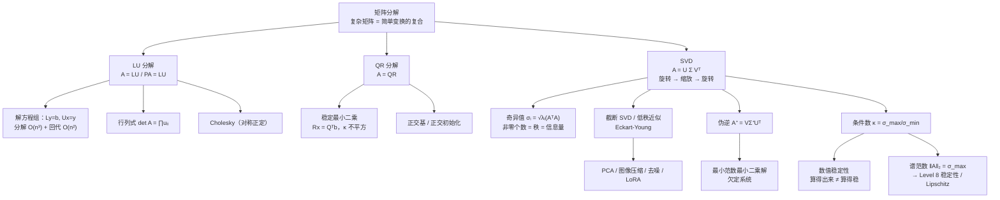

# Level 6 矩阵分解

> 整数可以分解成素数的乘积，多项式可以分解成一次因式——**矩阵也可以"拆开"**。Level 5 的特征分解想"对角化"矩阵，但要求方阵且可对角化，太苛刻。Level 6 回答一个更强的问题：**任意矩阵（哪怕长方形、哪怕不可逆）都能拆成"简单变换的复合"吗？** 答案是 SVD；而通往它的路上，还有两个更朴素的分解：LU 与 QR。
>
> 知识主线：**分解 = 把复杂矩阵翻译成简单变换的复合 → LU（消元的矩阵形式）→ QR（正交化的矩阵形式）→ SVD（旋转→缩放→旋转的普适分解）→ 奇异值 = 信息量 → 伪逆（"不可逆矩阵的逆"）→ 条件数与数值稳定性（"算得出来 ≠ 算得稳"）→ 谱范数（为 Level 8 铺路）**

## 学习目标

完成本章后，你应该能够：

- 掌握 **LU、QR、SVD** 三类核心分解：能写出分解形式，说出各自的用途与适用场景；
- 理解**奇异值与"秩 = 信息量"**的关系：非零奇异值个数 = 秩，奇异值的衰减速度决定"有效信息"有多少；
- 会用**截断 SVD** 做低秩近似（图像压缩、PCA），理解 Eckart-Young 定理；
- 会用**伪逆 $A^+$** 求最小范数最小二乘解，说出它与正规方程、岭回归的关系；
- 建立**数值稳定性意识**：理解条件数 $\kappa = \sigma_{\max}/\sigma_{\min}$，能诊断病态问题；
- 理解**谱范数** $\|A\|_2 = \sigma_{\max}$，知道它为什么是 Level 8 稳定性分析的核心工具。

---

## 第一部分：LU 分解——消元法的矩阵形式

### 1. 从"消元步骤"到"矩阵乘法"

Level 2 的高斯消元：通过"把某行的倍数加到另一行"把矩阵化成上三角（行阶梯形）。关键在于：**每一步消元都是一个矩阵乘法**。

单位阵 $I$ 只做一次行变换得到的矩阵叫**初等矩阵**（elementary matrix）。例如"第 2 行减去 2 倍第 1 行"对应的初等矩阵是

$$
E_{21} = \begin{pmatrix} 1 & 0 & 0 \\ -2 & 1 & 0 \\ 0 & 0 & 1 \end{pmatrix}
$$

因为初等矩阵可逆（逆仍是初等矩阵，只需把系数变号），整个消元过程 $E_k \cdots E_1 A = U$ 可以反过来写成

$$
A = (E_k \cdots E_1)^{-1} U = LU
$$

其中 $U$ 是上三角（消元的**结果**），$L$ 是下三角、对角线全 1（消元的**操作记录**：$L$ 的 $(i,j)$ 位置恰好是消元时用到的乘数）。

> [!note] 直觉
> $U$ 是"消元做完的样子"，$L$ 是"做了哪些操作"的账本。$A = LU$ 读作：**先用 $U$ 这个上三角矩阵存储"结果"，再用 $L$ 里的乘数把它还原成 $A$**。一个分解，两份信息：结构和过程。

严格说，不带行交换的 $LU$ 要求每一步主元（pivot）都不为零。遇到零主元需要行交换，于是有**部分主元法**：$PA = LU$，$P$ 是置换矩阵。实际数值计算（包括 `np.linalg.solve`）一律用 $PA = LU$。

### 2. 为什么 LU 高效

- 复杂度：**分解一次 $O(n^3)$，回代一次 $O(n^2)$**。解 $Ax = b$ 拆成两步：$Ly = Pb$（前代）、$Ux = y$（回代），每个都是 $O(n^2)$ 的三角求解。
- 价值场景：**多个右端项**。要解 $Ax = b_1, Ax = b_2, \dots$ 时，只分解一次（$O(n^3)$），每个 $b$ 只需两次三角回代（$O(n^2)$）——若每次都重新消元就是 $O(n^3) \times k$，亏大了。
- 顺带的数值忌讳：**不要显式求 $A^{-1}$**。数值上求逆又贵又不稳（$np.linalg.inv$ 应尽量少用）；"解 $A^{-1}b$" 的正确姿势是 LU 分解 + 回代。
- 变体：$A$ 对称正定时用 **Cholesky 分解** $A = LL^T$（工作量减半，Level 5 正定矩阵在这里派上用场）。

### 3. LU 的用途

- **解方程组**：$Ax = b$ 的标准解法器（`np.linalg.solve` 底层就是 LAPACK 的 `gesv`，即 $PA=LU$）；
- **行列式**：$\det(A) = \det(L)\det(U) = \prod_i u_{ii}$（$L$ 对角线全 1 所以 $\det L = 1$；有行交换时乘以 $(-1)^{\text{交换次数}}$）。`np.linalg.det` 内部就是 LU；
- **秩与可逆性的初判**：$U$ 的主元个数 = 秩，主元全非零 ⇔ 可逆；
- **求逆**（理论联系，数值上不推荐显式做）。

**AI 应用（LU）**：所有"解线性系统"的封闭解法器都是 LU/Cholesky 的后台——线性/岭回归的解析解、高斯过程预测中的 $(K + \sigma^2 I)^{-1}\mathbf{y}$、卡尔曼滤波的更新步。凸优化里，牛顿法/内点法每一步都要解牛顿系统 $H \Delta\mathbf{x} = -\nabla f$，$H$ 对称正定时用 Cholesky；而 $H$ 的条件数直接决定优化收敛速度（这个"收费"在第五部分讲）。工程范式：`scipy.linalg.lu_factor` + `lu_solve`（分解一次、多次求解）。

---

## 第二部分：QR 分解——正交化的矩阵形式

### 4. Gram-Schmidt 的矩阵形式

Level 4 的 Gram-Schmidt 把线性无关向量组 $\{\mathbf{a}_1, \dots, \mathbf{a}_n\}$ 正交归一化：

$$
\mathbf{q}_i = \frac{\mathbf{a}_i - \sum_{j < i} \langle \mathbf{a}_i, \mathbf{q}_j \rangle\, \mathbf{q}_j}{\left\| \mathbf{a}_i - \sum_{j < i} \langle \mathbf{a}_i, \mathbf{q}_j \rangle\, \mathbf{q}_j \right\|}
$$

把系数收集进矩阵，就得到 **QR 分解**：

$$
A = QR
$$

- $Q$：$m \times n$，列是**正交归一基**（$Q^T Q = I_n$，张成 $\operatorname{Col}(A)$）；
- $R$：$n \times n$ **上三角**，$R_{ij} = \langle \mathbf{a}_j, \mathbf{q}_i \rangle$（$i \le j$），对角元是各步归一化前的长度。

直觉：$Q$ 是 $\operatorname{Col}(A)$ 里的一套"标准正交坐标系"，$R$ 记录"原来的列在新坐标系下的坐标"——这正是 Level 3"换基"思想的落地。正交基的好处：坐标好算、长度好算（$\|Q\mathbf{y}\| = \|\mathbf{y}\|$，正交矩阵保长度）。

### 5. 数值上的 QR：Householder 反射

经典 Gram-Schmidt（CGS）**数值上不稳定**：舍入误差累积，后面算出的 $\mathbf{q}_i$ 会逐渐失去与前面向量的正交性。改进版**修正 Gram-Schmidt**（MGS，先投影再归一化）好很多，但 LAPACK 实际采用的是 **Householder 反射**：每次用一个反射矩阵把一列变成"只有首项非零"，正交性误差保持在机器精度量级，$O(n^3)$ 稳定。

> [!warning] 概念原型 ≠ 工程实现
> 教科书里的 Gram-Schmidt 公式是**理解用的原型**；真正的数值库（LAPACK `geqrf`）用 Householder。自己写代码直接调 `np.linalg.qr`，不要自己实现 CGS。

### 6. QR 的用途：稳定最小二乘

最小二乘 $\min_x \|A\mathbf{x} - \mathbf{b}\|_2$ 的数学解是**正规方程** $A^T A \mathbf{x} = A^T \mathbf{b}$。但它有个致命伤：**$A^T A$ 把条件数平方了**（$\kappa(A^T A) = \kappa(A)^2$，见第五部分），矩阵一病态就完蛋。

QR 方案：代入 $A = QR$ 并利用"正交矩阵保长度"，

$$
\|A\mathbf{x} - \mathbf{b}\|_2^2 = \|R\mathbf{x} - Q^T\mathbf{b}\|_2^2 + \|(I - QQ^T)\mathbf{b}\|_2^2
$$

第二项与 $\mathbf{x}$ 无关（是 $b$ 落在列空间正交补里的部分，永远消不掉），所以最小化等价于解一个**上三角方程组**：

$$
R\mathbf{x} = Q^T\mathbf{b}
$$

回代即可。且 $\kappa(R) = \kappa(A)$——**不平方**。这就是 QR 的稳定性优势：**解最小二乘，用 QR 或 SVD，别用正规方程**（除非条件数本来就很小）。

**AI 应用（QR）**：`np.linalg.lstsq` / `scipy.linalg.lstsq(lapack_driver='gelsy')` 是所有"线性模型拟合"（回归、多项式拟合、AR 模型）的数值后端。深度学习的**正交初始化**：`torch.nn.init.orthogonal_` 对随机高斯矩阵做 QR（或 SVD）取 $Q$ 作权重，让深层线性网络的梯度不消失/不爆炸（Saxe et al. 2014, *Exact solutions to the nonlinear dynamics of learning in deep linear neural networks*）。大规模迭代算法（Arnoldi/Lanczos、随机化 SVD，Halko et al. 2011）也靠"类 Gram-Schmidt"的正交化步骤——推荐系统、大规模 PCA 的工程底座。

---

## 第三部分：SVD——矩阵的"极限分解"

### 7. 定理：任意矩阵 = 旋转 × 缩放 × 旋转

**奇异值分解（singular value decomposition, SVD）**：任意 $m \times n$ 实矩阵 $A$ 都可以分解为

$$
A = U \Sigma V^T
$$

各因子的维度与含义（**最容易搞错的地方**）：

| 因子 | 维度 | 含义 |
| --- | --- | --- |
| $U$ | $m \times m$ 正交 | **左奇异向量**（left singular vectors）$\mathbf{u}_1,\dots,\mathbf{u}_m$ = $AA^T$ 的单位特征向量，是输出空间 $\mathbb{R}^m$ 的正交基 |
| $\Sigma$ | $m \times n$ **矩形对角** | 对角元 $\Sigma_{ii} = \sigma_i$ 即**奇异值**（singular values）：$\sigma_1 \ge \sigma_2 \ge \dots \ge \sigma_r > 0 = \sigma_{r+1} = \dots = 0$，$r = \operatorname{rank}(A)$ |
| $V$ | $n \times n$ 正交 | **右奇异向量**（right singular vectors）$\mathbf{v}_1,\dots,\mathbf{v}_n$ = $A^T A$ 的单位特征向量，是输入空间 $\mathbb{R}^n$ 的正交基 |

奇异向量与奇异值通过 **$A\mathbf{v}_i = \sigma_i \mathbf{u}_i$** 一一对应：$A$ 把输入方向 $\mathbf{v}_i$ 精确映射到输出方向 $\mathbf{u}_i$，长度放大 $\sigma_i$ 倍；$i > r$ 的方向被压成零。

**几何意义**：$A$ 的作用 = 三步复合——

1. $V^T$：在输入空间**旋转**（换到奇异向量坐标系）；
2. $\Sigma$：沿坐标轴**缩放** $\sigma_i$ 倍（长方形矩阵还包含丢弃/补零维度）；
3. $U$：在输出空间**旋转**（换回标准坐标系）。

> [!abstract] 为什么说 SVD 是"极限分解"
> 单位球面经过 $A$ 变成**椭圆体**：半轴方向 = 左奇异向量，半轴长 = 奇异值。$\sigma_{\max}$ 是最大放大倍数，$\sigma_{\min}$ 是最小放大倍数。对比 Level 5：特征分解 $A = P\Lambda P^{-1}$ 要求**方阵且可对角化**，且 $P$ 一般不正交；SVD 对**一切矩阵**成立、因子都正交——SVD 是特征分解的"普适版"，把"旋转-缩放"拆到了最彻底。

### 8. 奇异值与特征值的关系

$$
\sigma_i = \sqrt{\lambda_i(A^T A)}
$$

$A^T A$ 是 $n \times n$ **半正定**矩阵（特征值 $\ge 0$），所以开方合法。对对称矩阵，奇异值 = 特征值的绝对值：$\sigma_i = |\lambda_i|$。$A^T A$ 与 $AA^T$ 的非零特征值完全相同（都是 $\sigma_i^2$），这就是 $U$、$V$ 分别取它们特征向量的原因。

> [!warning] 数值禁忌
> 数学上 $\sigma_i = \sqrt{\lambda_i(A^T A)}$ 是**定义方式**，但数值上**严禁**"先算 $A^T A$ 再做特征分解"——这会把条件数平方（见第五部分）。永远直接 `np.linalg.svd`。

**"秩 = 信息量"**：非零奇异值的个数 = $\operatorname{rank}(A)$；零奇异值个数 = 被压扁的方向数（方阵时即 nullity，呼应 Level 3 的秩-零化度定理 $n - r$）。奇异值谱（singular value spectrum）就是矩阵/数据的"信息分布曲线"：**大的 $\sigma$ 承载结构，小的 $\sigma$ 承载噪声与冗余**。$\sigma_i$ 衰减越快，"有效秩"越低——数据实质上只占一个低维子空间。这就是低秩近似与压缩的直觉基础。

### 9. 紧奇异值分解与低秩近似

**紧/瘦奇异值分解（compact / thin SVD）**：只保留非零奇异值部分，

$$
A = U_r \Sigma_r V_r^T
$$

其中 $U_r$ 是 $m \times r$（列正交）、$\Sigma_r$ 是 $r \times r$ 正定对角、$V_r$ 是 $n \times r$。零奇异值部分不携带信息，丢掉省存储、省计算。`np.linalg.svd(A, full_matrices=False)` 返回的就是瘦版本（$\min(m,n)$ 个奇异值；满秩时即紧分解）。

**截断 SVD（truncated SVD）**：只保留前 $k$ 个奇异值，$A_k = U_k \Sigma_k V_k^T$。它为什么是"最好的压缩"？由 **Eckart-Young 定理**：

$$
\min_{\operatorname{rank}(B) \le k} \|A - B\|_F^2 = \|A - A_k\|_F^2 = \sigma_{k+1}^2 + \sigma_{k+2}^2 + \dots + \sigma_r^2
$$

在所有"秩不超过 $k$"的矩阵里，截断 SVD 是 $A$ 的**最优近似**（Frobenius 范数与谱范数意义下）。代价：$mn$ 个参数换成 $k(m + n + 1)$ 个参数；误差完全由被丢弃的奇异值决定——$\sigma$ 衰减越快，压缩越划算。PCA 里的"解释方差比例"就是

$$
\frac{\sum_{i=1}^{k} \sigma_i^2}{\sum_{i=1}^{r} \sigma_i^2}
$$

（协方差矩阵的特征值 = 奇异值的平方，Level 7 细讲）。

**AI 应用（SVD）**——本章的核心应用区：

- **PCA 的稳定实现**：数据中心化后对数据矩阵做 $X = U\Sigma V^T$，主成分方向 = $V$ 的列、得分 = $U\Sigma$、解释方差 = $\sigma_i^2$ 占比。`sklearn.decomposition.PCA` 的 `svd_solver='full'` 走 LAPACK `gesdd`，`'randomized'` 走随机化 SVD（Halko et al. 2011）——**比"对协方差 $X^T X$ 做特征分解"数值稳定得多**（避免平方条件数）；
- **图像压缩与去噪**：灰度图就是 $m \times n$ 矩阵，存 $U_k, \Sigma_k, V_k$（$k(m+n+1)$ 个数）近似原图；去噪 = 把小奇异值置零（噪声通常集中在低 $\sigma$ 方向）；
- **推荐系统协同过滤（隐语义模型）**：Funk SVD（Netflix Prize，2006）把用户-物品评分矩阵 $R \approx P Q^T$（SVD 的语言：$R \approx U_k \Sigma_k V_k^T$），预测 $\hat{r}_{ui} = \mathbf{p}_u^T \mathbf{q}_i$（用户潜在因子 × 物品潜在因子），只对已知评分做 SGD 学习；工程实现：Spark MLlib 的 ALS、`surprise` 库的 SVD（加正则化与缺失值处理，即矩阵补全）；
- **低秩近似：LoRA**（Hu et al., 2021）：微调时冻结权重 $W_0$，只学低秩增量 $\Delta W = B A$（$B \in \mathbb{R}^{d \times r}$，$A \in \mathbb{R}^{r \times d}$，$r \ll d$），可训练参数从 $d^2$ 降到 $2dr$——理论依据是"预训练模型微调时的权重更新具有**低内在秩**（intrinsic rank）"，这正是"增量矩阵的低秩近似"；模型压缩同理：对全连接层做 $W \approx U_k \Sigma_k V_k^T$ 的奇异值剪枝（singular value pruning）。

---

## 第四部分：伪逆——"不可逆矩阵的逆"

### 10. 动机与定义

$A$ 不可逆（长方形，或方阵但奇异）时，$A\mathbf{x} = \mathbf{b}$ 可能**无解**（$\mathbf{b} \notin \operatorname{Col}(A)$，超定）或**无穷多解**（欠定）。伪逆给出"最好的答案"。

**Moore-Penrose 伪逆（pseudoinverse）**：由 SVD $A = U\Sigma V^T$ 直接得到

$$
A^+ = V \Sigma^+ U^T
$$

其中 $\Sigma^+$ 是 $n \times m$ 矩阵：把 $\Sigma$ 转置，非零奇异值取倒数 $\frac{1}{\sigma_i}$，零奇异值保持 0。

> [!note] 直觉：伪逆 = 沿奇异方向"反转"
> $A$ 沿方向 $\mathbf{v}_i$ 放大 $\sigma_i$ 倍到达 $\mathbf{u}_i$；伪逆就沿 $\mathbf{u}_i$ 缩小 $\frac{1}{\sigma_i}$ 倍送回 $\mathbf{v}_i$。**被压扁的方向（$\sigma = 0$）信息已经丢失，无法恢复，于是置 0**——"能反转的反转，不能反转的放弃"。

伪逆满足四条 Moore-Penrose 性质（$AA^+A = A$、$A^+AA^+ = A^+$、$AA^+$ 与 $A^+A$ 对称），且在这些性质下唯一。计算上直接 `np.linalg.pinv`（内部就是 SVD）。

### 11. 最小范数最小二乘解

对任意 $\mathbf{b}$，$\mathbf{x}^* = A^+\mathbf{b}$ 同时是：

1. **最小二乘解**：$\|A\mathbf{x}^* - \mathbf{b}\| \le \|A\mathbf{x} - \mathbf{b}\|$ 对一切 $\mathbf{x}$ 成立（在 $\operatorname{Col}(A)$ 里离 $\mathbf{b}$ 最近）；
2. **最小范数解**：在所有最小二乘解中，$\|\mathbf{x}^*\|$ 最小。

两个特例对照（帮助理解）：

| 情形 | 伪逆 | 结果 |
| --- | --- | --- |
| 列满秩（$m \ge n$，rank $= n$） | $A^+ = (A^T A)^{-1} A^T$（左逆） | 最小二乘解**唯一**；QR/SVD 是它的稳定实现 |
| 行满秩（$n \ge m$，rank $= m$） | $A^+ = A^T (A A^T)^{-1}$（右逆） | 相容时给出**最小范数解**（欠定系统里"最省的答案"） |

**与正则化的关系**：岭回归解 $(X^T X + \lambda I)^{-1} X^T \mathbf{y}$ 等价于把伪逆里的每个 $\frac{1}{\sigma_i}$ 换成 $\frac{\sigma_i}{\sigma_i^2 + \lambda}$——$\lambda > 0$ 阻止了 $\sigma_i \to 0$ 时 $\frac{1}{\sigma_i}$ 的爆炸。**正则化 = 伪逆的数值稳定化**（Level 7 展开）。

**AI 应用（伪逆）**：欠定回归（特征数 > 样本数，$d > n$）时正规方程无唯一解，$A^+\mathbf{b}$ 自动选**最小范数解** = "最简解释"；深度学习里 SGD 收敛到的解常带最小范数倾向（隐式正则化 implicit regularization，Gunasekar et al. 2017 对线性网络的分析），伪逆是"最小范数解"的精确原型。图像去模糊、超分辨率、CT 重建等病态反问题 $A\mathbf{x} = \mathbf{b}$ 用伪逆/正则化伪逆求解；机器人逆运动学用雅可比伪逆 $J^+$ 求关节速度（Level 8 雅可比矩阵预告）。工程上 `np.linalg.lstsq` 默认就是 SVD + 伪逆。

---

## 第五部分：数值稳定性与条件数

### 12. "算得出来 ≠ 算得稳"

计算机存浮点数（double ≈ 16 位有效数字），每一步运算都有舍入误差。问题不是"有没有误差"，而是**误差会不会被放大**。

经典例子：**希尔伯特矩阵** $H_{ij} = \frac{1}{i + j - 1}$。$n = 10$ 时条件数 $\kappa \approx 10^{13}$——矩阵非奇异，`np.linalg.solve` 能算出"解"，但解的误差被放大 $10^{13}$ 倍，等于没算。

> [!warning] 最危险的不是报错，而是不报错
> 奇异矩阵会让 `np.linalg.solve` 抛 `LinAlgError`——你**知道**出问题了。病态矩阵不报错、照常返回一个数——你**不知道**答案全错。数值分析要防的正是后者。

### 13. 条件数

**条件数（condition number）**：

$$
\kappa(A) = \|A\|_2 \, \|A^+\|_2 = \frac{\sigma_{\max}}{\sigma_{\min}}
$$

（$\sigma_{\min}$ 指非零奇异值中最小的那个；不可逆时 $\kappa = \infty$。）

**误差界的直觉版**：$b$ 有相对误差 $\epsilon$，解 $\mathbf{x}$ 的相对误差至多约 $\kappa(A) \cdot \epsilon$。$\kappa \approx 1$：**良态**（well-conditioned）；$\kappa$ 巨大：**病态**（ill-conditioned）。注意条件数描述的是**问题本身**对扰动的敏感度，不是算法的错——但算法可以做得更好或更差（比如正规方程主动把 $\kappa$ 平方了）。

**关键推论**：$\kappa(A^T A) = \kappa(A)^2$。这就是本笔记反复强调的一条主线：**解最小二乘用 QR/SVD，算 PCA 用 SVD，而不是解正规方程 / 对协方差做特征分解**——后两者把条件数平方，本来 $\kappa = 10^6$ 就够呛，平方成 $10^{12}$ 直接爆掉。

诊断手段：`np.linalg.cond(A)` 直接算条件数；或看 $\sigma_{\min}$：当 $\sigma_{\min} \lesssim \epsilon_{\text{mach}}\, \sigma_{\max}$（$\epsilon_{\text{mach}} \approx 2.2 \times 10^{-16}$）时矩阵在数值上等同奇异。

### 14. 谱范数与矩阵范数

矩阵范数两大类：

- **诱导范数（算子范数）**，由向量范数诱导：$\|A\|_2 = \max_{\mathbf{x} \ne 0} \frac{\|A\mathbf{x}\|_2}{\|\mathbf{x}\|_2} = \sigma_{\max}(A)$，即矩阵作为变换的**最大放大倍数**，称为**谱范数（spectral norm）**；
- **分量型范数**：Frobenius 范数 $\|A\|_F = \sqrt{\sum_{i,j} a_{ij}^2} = \sqrt{\sum_i \sigma_i^2}$（用奇异值写最漂亮，也是截断 SVD 误差的度量）。

条件数正是谱范数视角下的"最大/最小放大之比"：$\kappa = \sigma_{\max}/\sigma_{\min} = \|A\|_2 \|A^+\|_2$。

**为什么谱范数重要**：它度量变换的**最坏拉伸**。深度学习里，一层权重 $W$ 的谱范数 = 该层的 **Lipschitz 常数**（输出变化 ≤ $\|W\|_2 \times$ 输入变化），整个网络的稳定性由各层谱范数乘积控制——这是 Level 8 稳定性分析的核心工具，本 Level 先把概念立住。

**AI 应用（数值稳定性/谱范数）**：

- **谱归一化（spectral normalization）**，Miyato et al. 2018，GAN：训练中每步把权重除以它的谱范数（用幂迭代 power iteration 估计 $\sigma_{\max}$），强制每层 Lipschitz 常数 ≤ 1，稳定 GAN 训练——谱范数最直接的工程用法；
- **对抗鲁棒性**：网络 Lipschitz 上界 = 各层谱范数乘积，约束它 = 约束对抗扰动的影响上限（Level 8）；
- **优化收敛**：梯度下降的收敛速度依赖 Hessian 的条件数（病态 → 之字形震荡）；预条件（preconditioning）与 BatchNorm/LayerNorm 的本质都是"降条件数"（Level 7/8）；
- **数据科学陷阱**：特征共线（多重共线性）时设计矩阵 $X$ 病态，直接正规方程得到的回归系数不可信——先 `np.linalg.cond(X)` 检查；`sklearn` 的 `Ridge` 自带 $\lambda$ 正是工程上的保险。

---

## 常见误区汇总

1. **"SVD 只对可逆方阵 / 对称矩阵定义"** → 任意矩阵（长方形、奇异都行）都有 SVD；要求"方阵且可对角化"的是特征分解；
2. **"$\Sigma$ 是 $m\times m$ 或 $n\times n$ 对角阵"** → $\Sigma$ 是 **$m \times n$ 矩形对角阵**；$U$ 是 $m \times m$，$V$ 是 $n \times n$。维度是 SVD 最容易错的地方；
3. **"奇异值 = 特征值"** → $\sigma_i = \sqrt{\lambda_i(A^T A)}$；只有对称（半）正定矩阵才有 $\sigma = |\lambda|$；
4. **"算 SVD 就先算 $A^T A$ 再特征分解"** → 数学等价、数值灾难（平方条件数）；永远直接 `np.linalg.svd`；
5. **"最小二乘 = 解正规方程 $A^T A \mathbf{x} = A^T \mathbf{b}$"** → 数学上正确、数值上危险（$\kappa$ 平方）；稳定实现是 QR 或 SVD；
6. **"LU 分解就是消元法本身"** → 消元只是过程；LU 的价值在"分解一次 $O(n^3)$、多次求解 $O(n^2)$"，且无主元时 LU 不存在（必须 $PA = LU$）；
7. **"$A^+\mathbf{b}$ 只是最小二乘解"** → 它是最小二乘解里**范数最小**的那个；欠定系统里"选哪个解"正是由范数最小决定的；
8. **"条件数大 = 算法写错了"** → 条件数描述**问题本身**对扰动的敏感度；好算法（QR/SVD、部分主元）只是不额外放大误差，改变不了问题本质。

---

## 知识结构图

## 思考问题

1. 为什么特征分解要求"方阵 + 可对角化"，SVD 却对一切矩阵成立？两者的几何差别在哪？
2. 对 $A = \begin{pmatrix} 1 & 1 \\ 2 & 2 \end{pmatrix}$：秩是几？写出它的紧 SVD（提示：先看 $A^T A$ 的秩 1 结构）。$\sigma_2$ 为什么是 0？
3. 若 $\kappa(A) = 10^6$，$\kappa(A^T A)$ 是多少？用正规方程解最小二乘，误差可能被放大多少倍？
4. 一张 $512 \times 512$ 灰度图用秩 $k = 50$ 的截断 SVD 近似，需要存多少个数？相比 $512^2$ 压缩了多少倍？（提示：$k(m+n+1)$）
5. $A$ 是 $3 \times 5$ 矩阵、$\operatorname{rank}(A) = 3$，$A\mathbf{x} = \mathbf{b}$ 有几个解？$A^+\mathbf{b}$ 是哪一个？为什么"最小范数"在这里是有意义的选择？
6. 经典 Gram-Schmidt 为什么数值上不可靠？Householder 反射靠什么保证正交性？（提示：误差是"累积"还是"一步到位"）
7. （预告 Level 7）特征高度共线时，为什么正规方程求出的回归系数不可信？岭回归的 $\lambda$ 把伪逆里的 $\frac{1}{\sigma_i}$ 换成了 $\frac{\sigma_i}{\sigma_i^2 + \lambda}$，这一步在数值上到底防住了什么？
8. LoRA 为什么"参数很少还能学得好"？"微调时的权重更新具有低内在秩"这个假设，与奇异值快速衰减（$\sigma$ 谱）有什么联系？

## 总结

**Level 6 的知识网络**：

**矩阵分解（LU：消元之形 / QR：正交化之形 / SVD：普适的旋转-缩放-旋转）→ 奇异值 = 每个方向的放大倍数 = 信息量 → 截断 SVD = 可证明最优的低秩近似（Eckart-Young）→ 伪逆 = 沿奇异方向"能反转就反转"（最小范数最小二乘）→ 条件数 = σ_max/σ_min = 误差放大上限 → 谱范数 = σ_max = Level 8 稳定性的入场券**

一句话总结：**"分解"把"一个看不懂的矩阵"翻译成"几个只做一件事的简单矩阵"：LU 把消元写成矩阵、QR 把正交化写成矩阵、SVD 把任意矩阵写成"旋转 → 缩放 → 旋转"；奇异值告诉你"信息有多少、藏在哪"（秩 = 信息量），条件数告诉你"算出来的东西可不可信"（算得出来 ≠ 算得稳）。** 下一章（Level 7）将把 SVD、伪逆、条件数接到机器学习模型上：PCA 降维、岭回归与正则化、数据矩阵的几何。

## 推荐资料

- **3Blue1Brown《奇异值分解（SVD）》**——难度：零基础。理由：把 $A = U\Sigma V^T$ 的"旋转 → 缩放 → 旋转"做成动画，几何直觉一次到位，建议学 SVD 前后各看一遍。
- **Strang《Introduction to Linear Algebra》第 6–7 章**——难度：入门–中等。理由：第 6 章特征值之后自然引出 SVD（"特征值的平方根"视角），第 7 章把 SVD、伪逆与最小二乘串起来；配 MIT 18.06 视频第 29–32 讲。
- **Stanford CS229 讲义（SVD 与 PCA 部分）**——难度：中等。理由：ML 视角的 SVD/PCA：数据中心化、解释方差、与特征分解的数值对比，直接衔接 Level 7。
- **《统计学习导论》(ISLR) 降维章节**——难度：入门–中等。理由：PCA 在真实数据上的应用直觉与实操（R/Python 代码），可与 sklearn 对照学习。

> 若遇到解决不了的疑问，请在笔记中用 `> [!question]` 标记，按 config.md 的规范跟踪解决。

## Related Notes

- [[Level5_Eigenvalues_and_Eigenvectors|Level 5 特征值与特征向量]] —— 前置基础
- [[Level7_Linear_Algebra_in_ML|Level 7 机器学习中的线性代数]] —— 下一章
- [[Linear Algebra MOC]] —— 知识库总览
- [[Learning_Roadmap]] —— 学习路线
- [[Glossary]] —— 术语表
